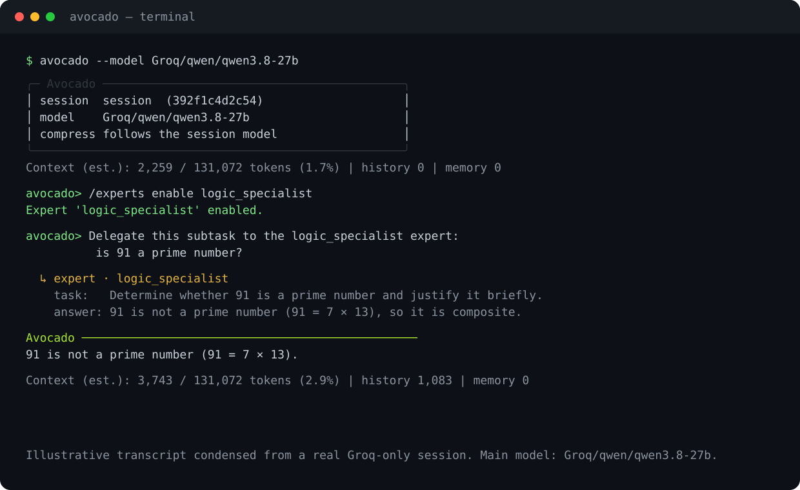

<div align="center">

```
 █████╗ ██╗   ██╗ ██████╗  ██████╗  █████╗ ██████╗  ██████╗
██╔══██╗██║   ██║██╔═══██╗██╔════╝ ██╔══██╗██╔══██╗██╔═══██╗
███████║██║   ██║██║   ██║██║      ███████║██║  ██║██║   ██║
██╔══██║╚██╗ ██╔╝██║   ██║██║      ██╔══██║██║  ██║██║   ██║
██║  ██║ ╚████╔╝ ╚██████╔╝╚██████╗ ██║  ██║██████╔╝╚█████╔╝
╚═╝  ╚═╝  ╚═══╝   ╚═════╝  ╚═════╝ ╚═╝  ╚═╝╚═════╝   ╚═════╝
                               C L I   A S S I S T A N T
```

**A lightweight terminal AI agent that routes work between a cheap main model and stateless experts, so expensive models are used only where they matter.**

[Overview](#overview) · [Demo](#see-it-in-action) · [Quick start](#quick-start) · [Usage](#usage) · [Configuration](#configuration) · [Architecture](#architecture) · [Security](#security) · [Tests](#tests) · [License](#license)

</div>

## Overview

**Avocado** is a terminal AI agent for coding, analysis, and file work. Instead of sending every step to one large model, it lets you distribute work explicitly:

- A cheap or local model handles routine steps.
- Stateless experts receive only the precise subtask they need, with no conversation history.
- Session history is folded into compact long-term memory by AI compression.
- Tools are connected manually, so only the tools you need appear in the prompt.
- The base system prompt is small; context grows only with enabled experts, tools, plan, and memory.
- Runs anywhere Python runs, including Termux on Android.

The result is a small, predictable context window and lower token spend for long sessions.

## See it in action



The demo enables a stateless expert and delegates a question to it. The main model keeps the conversation; the expert only sees the subtask and its answer. The transcript below is condensed from a real Groq-only session with the code-loop step logs trimmed.

<details>
<summary>Text transcript</summary>

```text
$ avocado --model Groq/qwen/qwen3.8-27b

╭─ Avocado ───────────────────────────────────────────╮
│ session  session  (392f1c4d2c54)                    │
│ model    Groq/qwen/qwen3.8-27b                      │
│ compress follows the session model                  │
╰─────────────────────────────────────────────────────╯
Context (est.): 2,259 / 131,072 tokens (1.7%) | history 0 | memory 0

avocado> /experts enable logic_specialist
Expert 'logic_specialist' enabled.

avocado> Delegate this subtask to the logic_specialist expert:
          is 91 a prime number?

  ↳ expert · logic_specialist
    task:   Determine whether 91 is a prime number and justify it briefly.
    answer: 91 is not a prime number (91 = 7 × 13), so it is composite.

Avocado ────────────────────────────────────────────────
91 is not a prime number (91 = 7 × 13).

Context (est.): 3,743 / 131,072 tokens (2.9%) | history 1,083 | memory 0
```

</details>

## Why Avocado

### Experts: precise delegation

Avocado lets you attach different expert models for different domains instead of stuffing everything into a single model. The main model delegates only the exact subtask to the chosen expert.

| Domain | Example expert models | What they do |
|---|---|---|
| Coding | Qwen Coder, DeepSeek-Coder, gpt-oss | Write, review, and fix code |
| Math and logic | Qwen, DeepSeek-Math | Solve formulas, algorithms, logic puzzles |
| Medicine | Meditron, BioMistral, fine-tuned Llama/Mistral | Medical consultation, symptom analysis |
| Translation | NLLB, M2M100, Qwen (multilingual) | Translate between languages |
| Domain-specific | Fine-tunes on Llama / Mistral / Qwen | Technical docs, engineering calculations |

Each expert is **stateless**: it does not see the whole conversation, session plan, or memory. It receives only what the main model explicitly passes. An expert can run **without tools** as an isolated chat model, or with an explicit subset of tools.

Enabling an expert requires the **main** model to support an agent loop (`supports_code_loop` or `supports_tool_calling`). Chat-only main models can still answer normally but cannot attach tools or experts.

### Memory compression

When a model fills more than half of its context window, it often starts to hallucinate and get confused, even if it formally still fits. Avocado folds the step journal into compact long-term memory so small-context models stay in the zone of clarity instead of losing track of the task.

### Advantages

| Mechanism | What it gives |
|---|---|
| Expert delegation | Expensive or heavy models work only on precise subtasks, without junk context |
| AI memory compression | The step journal becomes compact `memory.md`; long sessions do not burn tokens |
| Manual tool connection | Only attached tools add their schema to the prompt; less noise, lower cost |
| Small base prompt | A lean system prompt that grows only with enabled experts, plan, and memory |
| Portability | Python CLI, minimal dependencies, runs in Termux, on old laptops, and Raspberry Pi |

## Quick start

### Requirements

- Python **3.11+**
- `pip`
- An API key for at least one provider

### Install

```bash
pip install -e .
avocado --help
```

You can also run the package directly with `python3 -m srs`.

### Configure keys

Keys are read from environment variables, then from the OS keyring. They are never stored in the repository.

```bash
export GEMINI_API_KEY="..."
export GROQ_API_KEY="..."
export OPENAI_API_KEY="..."
export ANTHROPIC_API_KEY="..."
```

The environment variable name for each provider is set by its `api_key_env` field in the config.

### Run

```bash
avocado --model Google/gemini-3.8-flash
```

If you want a Groq-only setup, use a loop-capable Groq model:

```bash
avocado --model Groq/qwen/qwen3.8-27b
```

On first run Avocado copies the packaged config to `~/.config/avocado/config.json`, then opens the latest session (or creates one).

### One-shot mode

Run a single task, save the session, and exit:

```bash
avocado --once "Summarize the files in this directory"
```

## Usage

### CLI flags

| Flag | Purpose |
|---|---|
| `--config <path>` | Use a specific `config.json` (sets `AVOCADO_CONFIG_PATH`) |
| `--model <label>` | Start with a model such as `Google/gemini-3.8-flash` |
| `--session <id\|name>` | Open a specific session |
| `--sessions-dir <path>` | Override the sessions storage root |
| `--once <task>` | Run one task, then save and exit |
| `--no-compress-on-exit` | Do not compress the step journal when exiting |

### Slash commands

| Command | Purpose |
|---|---|
| `/help` | Show help |
| `/sessions` | List saved sessions |
| `/new [name]` | Create and switch to a new session |
| `/switch <id\|name>` | Compress the current session, then switch |
| `/rename <name>` | Rename the current session |
| `/delete <id\|name>` | Delete a non-active session |
| `/plan` | Show the current plan |
| `/memory` | Show memory paths and a preview |
| `/model [list]` | List models and their capabilities |
| `/model <label>` | Switch the session model |
| `/tools [list]` | List registered and active tools |
| `/tools add <name\|*>` | Attach one tool or every built-in tool |
| `/tools remove <name>` | Detach a tool from this session |
| `/tools clear` | Detach every tool from this session |
| `/experts [list]` | List experts, expertise, and their tools |
| `/experts enable <role\|*>` | Attach one or all experts |
| `/experts disable <role\|*>` | Detach one or all experts |
| `/experts tools <role> [tool ...\|none]` | Set the tools an expert may use |
| `/compress` | Fold the raw step journal into `memory.md` |
| `/compress-model [list]` | List models used for memory compression |
| `/compress-model <label>` | Set the model used for memory compression |
| `/compress-model default` | Follow the session model again |
| `/reset [--hard]` | Clear current history; `--hard` also clears memory |
| `/context` | Show estimated context usage and limits |
| `/quit`, `/exit` | Save and exit |

Any other input is sent to the main agent.

### Experts

```text
/experts enable logic_specialist
/experts tools code_reviewer read_file
```

By default an expert has no tools. Grant tools explicitly only when its task needs them. Every expert call is shown in the terminal as `↳ expert · <role>` with its task and answer.

### Termux on Android

```bash
pkg update && pkg install python
cd Avocado_AI_CLI
pip install -e .
export GROQ_API_KEY="..."
avocado --model Groq/qwen/qwen3.8-27b
```

## Memory model

| Layer | File | Compressed? | In context? | Purpose |
|---|---|---|---|---|
| Plan / status | `plan.json` | No | Yes | Current task, steps, status |
| Long-term memory | `memory.md` | Yes (AI compression) | Yes | Facts, data, open questions, fixes |
| Raw journal of current run | `current_run.jsonl` | No | No (compression only) | Raw steps, tool calls, errors |
| Archived journal | `archive/run-*.jsonl` | No | No | Audit, debug, recovery |
| Compression metadata | `memory.meta.json` | No | No | Token statistics before and after |

The compressor merges the previous compressed summary with new steps from the current run. It does **not** read the whole accumulated archive.

Compression runs automatically on `/switch` and on exit when the journal has content. You can control this with `compress_on_switch` and `compress_on_exit` in the config, or disable it per run with `--no-compress-on-exit`. `/compress-model` lets you use a cheaper model for compression than for the main task.

## Configuration

Configuration is resolved in this order:

1. `--config <path>` on the command line.
2. `$AVOCADO_CONFIG_PATH`.
3. A single-root layout when `$AVOCADO_HOME` is set (`$AVOCADO_HOME/config.json`).
4. XDG paths: `$XDG_CONFIG_HOME/avocado/config.json` (default `~/.config/avocado/config.json`).

Sessions are stored under:

1. `--sessions-dir <path>`.
2. `agent_config.sessions.root`.
3. `$AVOCADO_HOME/sessions`.
4. `$XDG_DATA_HOME/avocado/sessions` (default `~/.local/share/avocado/sessions`).

`state` and `cache` directories follow the same XDG or `$AVOCADO_HOME` rules.

### Example

```json
{
  "project_name": "Avocado_AI_CLI",
  "agent_config": {
    "agent_name": "Avocado",
    "agent_type": "code",
    "max_steps": 20,
    "default_model": "Google/gemini-3.8-flash",
    "memory": {
      "compression": {
        "model": "",
        "max_summary_tokens": 0,
        "max_transcript_tokens": 0
      }
    }
  },
  "settings": {
    "providers": [
      {
        "id": "google",
        "name": "Google",
        "base_url": "https://generativelanguage.googleapis.com/v1beta/openai/",
        "api_key_env": "GEMINI_API_KEY",
        "models": [
          {
            "name": "gemini-3.8-flash",
            "context": 1048576,
            "max_output": 65536,
            "params": { "max_tokens": 4096, "max_steps": 20 },
            "supports_tool_calling": true,
            "supports_code_loop": true
          }
        ]
      },
      {
        "id": "groq",
        "name": "Groq",
        "base_url": "https://api.groq.com/openai/v1",
        "api_key_env": "GROQ_API_KEY",
        "models": [
          {
            "name": "openai/gpt-oss-120b",
            "context": 131072,
            "max_output": 65536,
            "params": { "max_tokens": 4096, "max_steps": 20 },
            "expert": true,
            "expertise": "code review",
            "supports_code_loop": false,
            "supports_tool_calling": false
          }
        ]
      }
    ],
    "experts": [
      {
        "role": "code_reviewer",
        "name": "Code Reviewer",
        "description": "Reviews code for correctness, quality and security",
        "expertise": "code review",
        "model": "Groq/openai/gpt-oss-120b",
        "agent_type": "chat",
        "allow_tools": false,
        "tools": []
      }
    ]
  }
}
```

Set `max_summary_tokens` or `max_transcript_tokens` to `0` to disable that limit. Positive values cap the compressed summary and the transcript sent to the compressor.

### Keys and the keyring

For each provider, Avocado reads `api_key_env` from the environment first, then from the OS keyring using the project name (`Avocado_AI_CLI`) as the service. On headless systems without a keyring backend, prefer environment variables. `/model list` marks models that cannot run tools or experts as `[chat-only]`.

## Architecture

```text
User --> avocado CLI --> SessionManager --> Engine --> Model (OpenAI-compatible API)
                             |             |
                             |             --> Tools (manual)
                             |             --> Experts (stateless)
                             --> MemoryCompressor --> Model
Session: plan.json, memory.md, current_run.jsonl
```

One request flows through five stages:

1. Gather instructions: system prompt + plan + memory + expert guidance.
2. Choose the engine by model capabilities: code loop, then tool calling, then chat.
3. Execute the task; steps are written to the journal.
4. `/compress` (or session switch/exit) turns the journal into updated `memory.md`.
5. The next run starts from compact context, not the whole history.

Key session files:

```text
session.json        metadata
plan.json           current plan (not compressed)
memory.md           compressed long-term memory
memory.meta.json    compression statistics
current_run.jsonl   raw step journal
archive/            archived journals
```

Package layout:

```text
srs/
  cli.py            interactive shell and slash commands
  entry.py          CLI entry point and --config handling
  paths.py          XDG / AVOCADO_HOME path resolution
  config/           config loading, validation, and packaged defaults
  llm/              engines, model factory, tools, experts, logging
  memory/           compression, plan, prompt, and token estimates
  sessions/         session store and manager
  secrets/          environment and keyring secret resolution
```

## Security

- API keys are read only from environment variables or the OS keyring; none are stored in the repository.
- Tools are connected manually. `run_shell` and `bash` remain inactive until you explicitly attach them.
- `delete_path` refuses to delete protected system paths.
- Sessions, plan, and memory are stored locally.
- There is no telemetry or analytics.

The code loop executes Python locally, and `run_shell` / `bash` use `shell=True`. This is powerful but **not** a sandbox. Run the agent with the same restrictions you would use for any local script.

## Limitations

- Code execution is local, without a container sandbox.
- Compression quality depends on the compression model.
- No cloud session synchronization.
- Terminal interface, no GUI.
- Providers connect through an OpenAI-compatible layer, not specialized SDKs.

## Troubleshooting

| Symptom | Fix |
|---|---|
| `Model '...' is chat-only and cannot use tools or experts` | Switch to a loop-capable main model such as Gemini or `Groq/qwen/qwen3.8-27b`, or disable tools/experts |
| `API key ... is not set` | Export the provider's `api_key_env` variable or store the key in the OS keyring |
| Keyring errors on a headless machine | Use environment variables instead of the keyring |
| `ConfigError: 'project_name' is required` | Add `project_name` to your `config.json` |
| `Compression model returned an empty summary` | Check the compression model and key, or choose another model with `/compress-model` |

## Tests

```bash
python3 -m unittest discover -s tests -v
```

The suite contains 117 tests and does not require real API keys; models are replaced with deterministic fakes.

## License

Licensed under the [Apache License 2.0](LICENSE). Copyright 2026 leonfesjuk.
